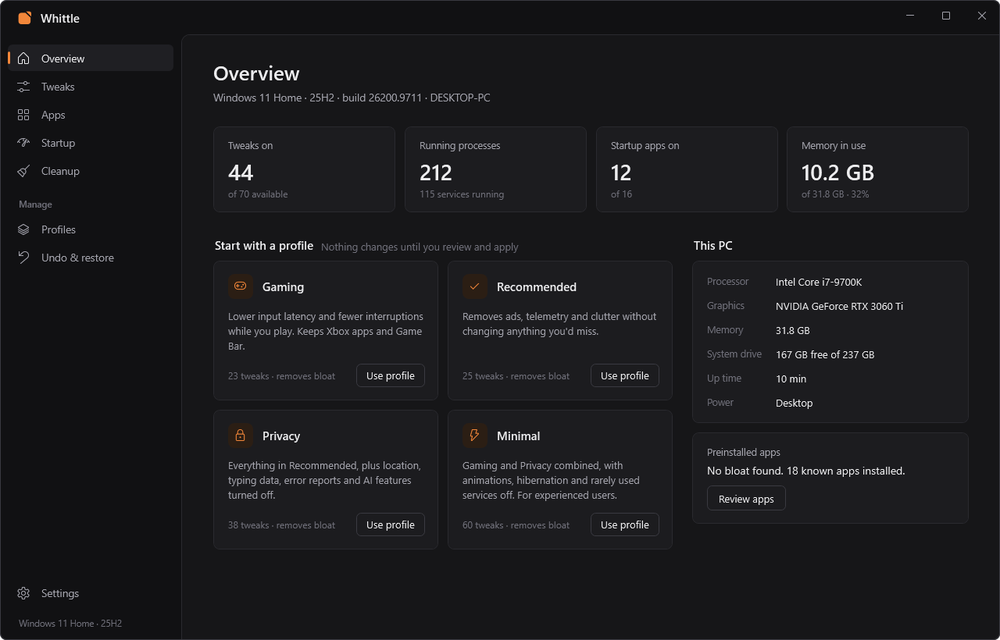
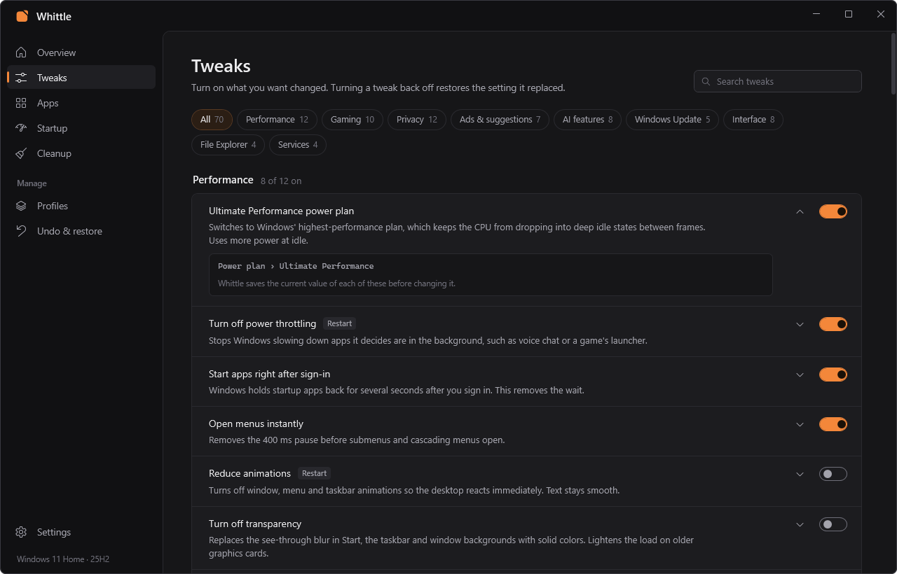
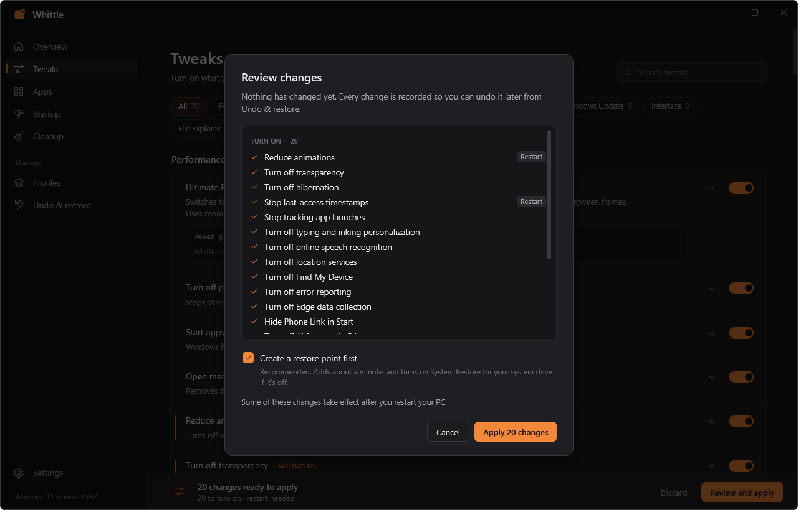
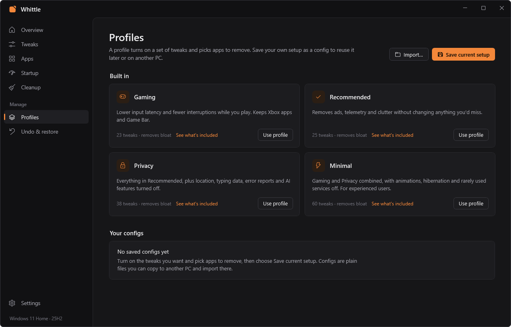
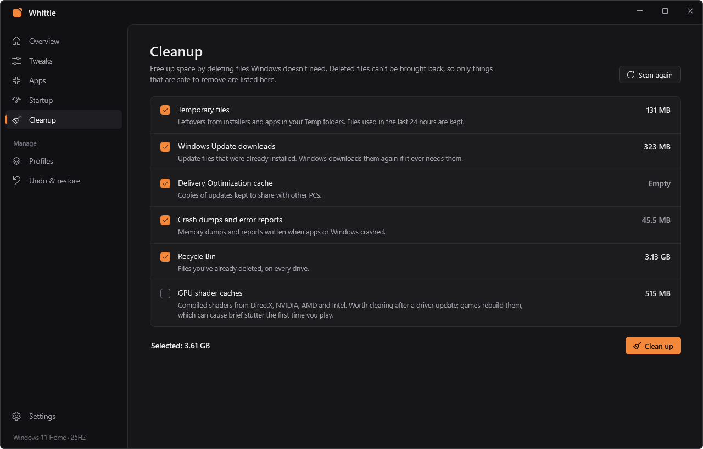

<p align="center">
  
</p>

<h1 align="center">Whittle</h1>

<p align="center">
  A careful debloater and tuner for Windows 11.<br>
  Removes the clutter, turns off telemetry and ads, tunes Windows for games, and can undo every change it makes.
</p>

<p align="center">
  <a href="../../releases/latest"><b>Download Whittle.exe</b></a>
</p>



## Getting started

1. Download `Whittle.exe` from the [latest release](../../releases/latest).
2. Run it and accept the administrator prompt.
3. Pick a profile or turn on individual tweaks, then choose **Review and apply**.

Nothing changes until you confirm the review. Whittle is a single portable file of about 350 KB. It runs on the .NET Framework 4.8 built into Windows, so there's nothing to install. Built and tested on Windows 11 25H2; it should also work on Windows 10, but that hasn't been tested.

## Features

| | |
| --- | --- |
| **Tweaks** | 70 tweaks in nine groups: Performance, Gaming, Privacy, Ads & suggestions, AI features, Windows Update, Interface, File Explorer and Services. Every tweak shows its trade-offs, and the arrow next to the switch lists exactly what it writes. |
| **Profiles** | Gaming, Recommended, Privacy and Minimal as starting points. |
| **Configs** | Save your setup, export it as a small `.whittle.json` file and import it on another PC. |
| **Apps** | Finds preinstalled apps and sorts them into *Recommended to remove*, *Optional* and *Keep unless you're sure*. |
| **Startup** | Turns startup apps on and off the same way Task Manager does. |
| **Cleanup** | Temp files, Windows Update downloads, Delivery Optimization cache, crash dumps, the Recycle Bin and GPU shader caches. |
| **Undo & restore** | Every change Whittle made, each with an Undo button, plus System Restore and a detailed log. |

<table>
  <tr>
    <td></td>
    <td></td>
  </tr>
  <tr>
    <td></td>
    <td></td>
  </tr>
</table>

### Profiles

- **Gaming**: Ultimate Performance power plan, hardware-accelerated GPU scheduling, Game Mode, windowed-game optimizations, no background recording, no mouse acceleration, no Sticky Keys pop-ups, game priority in the multimedia scheduler, no network throttling, and no driver updates or automatic restarts from Windows Update. Keeps Xbox apps and Game Bar.
- **Recommended**: telemetry, ads, suggestions, Copilot and Recall off, a few speed-ups, and no surprise restarts.
- **Privacy**: Recommended plus location, typing data, speech, error reports and the AI features in Edge, Chrome, Paint and Notepad.
- **Minimal**: everything above plus fewer animations, no hibernation, and rarely used services set to start only when needed.

No profile touches security settings. *Turn off Memory Integrity* is marked **Advanced** and changes only if you switch it on yourself.

## How undo works

Before changing anything, Whittle saves the exact original value in `%LocalAppData%\Whittle\journal.json`, or notes that the value didn't exist. Undo writes the originals back, deletes values that weren't there before, and removes registry keys Whittle created. For services and scheduled tasks it restores the previous startup type or enabled state. For the power plan it switches back to the plan you had.

You can undo in three ways:

- turn a tweak's switch off and apply,
- use **Undo** or **Undo all** on the *Undo & restore* page,
- roll the whole system back with the restore point Whittle creates before each run (on by default).

Removed apps aren't stored in the journal. The *Undo & restore* page links each one to its Microsoft Store page so you can reinstall it.

## What to expect

Debloating mostly cuts background activity: fewer processes and services, less disk and network use, and fewer interruptions. You'll mainly notice smoother frame times and fewer stutters rather than a big jump in average FPS. The largest gains usually come from hardware-accelerated GPU scheduling and turning off background recording. On older CPUs, turning off Memory Integrity can also help, if you accept the security trade-off.

> [!NOTE]
> Whittle changes system settings, services and installed apps. Every tweak is reversible and a restore point is created first by default, but use it at your own risk, the same as any tool of this kind.

## Building from source

```powershell
.\build.ps1          # dist\Whittle.exe
.\build.ps1 -Dev     # obj\dev\Whittle-dev.exe: no admin prompt, adds --selftest and --shot
```

The build uses `csc.exe` from .NET Framework 4.8, which ships with every Windows 10 and 11 PC, so no SDK is needed.

### Self-test

```powershell
.\obj\dev\Whittle-dev.exe --selftest report.txt
```

The self-test runs the tweak engine against a sandbox registry key, `HKCU\Software\WhittleSelfTest`, which it deletes afterwards. For every registry-based tweak it applies the tweak and checks the result. It then reloads the journal from disk, undoes the tweak, and confirms the original values and keys are back exactly as they were. It also checks the catalog, the journal and config file formats, and runs read-only scans of the current PC. GitHub Actions runs it on every push.

`--shot <folder>` renders every page to PNG without showing a window. It was used for the screenshots above.

### Project layout

```
src/Core     tweak engine, journal, catalogs, app removal, startup, cleanup
src/Shell    window, dialogs and UI helpers
src/Pages    one file per page
src/Theme.xaml   colors and control styles
tools/IconGen.cs renders the logo into assets/whittle.ico
```

### Releasing

1. Set the new version in `src/Brand.cs` (`Version = "1.1.0"`) and add an entry to `CHANGELOG.md`.
2. On GitHub, publish a release with the tag `v1.1.0`.
3. The **Build** workflow compiles `Whittle.exe`, runs the self-test and attaches the exe to the release.

## Credits

Tweak values and the list of preinstalled apps are adapted from [Win11Debloat](https://github.com/Raphire/Win11Debloat) by Raphire (MIT License). See [THIRD-PARTY-NOTICES.md](THIRD-PARTY-NOTICES.md).

## License

[MIT](LICENSE)
